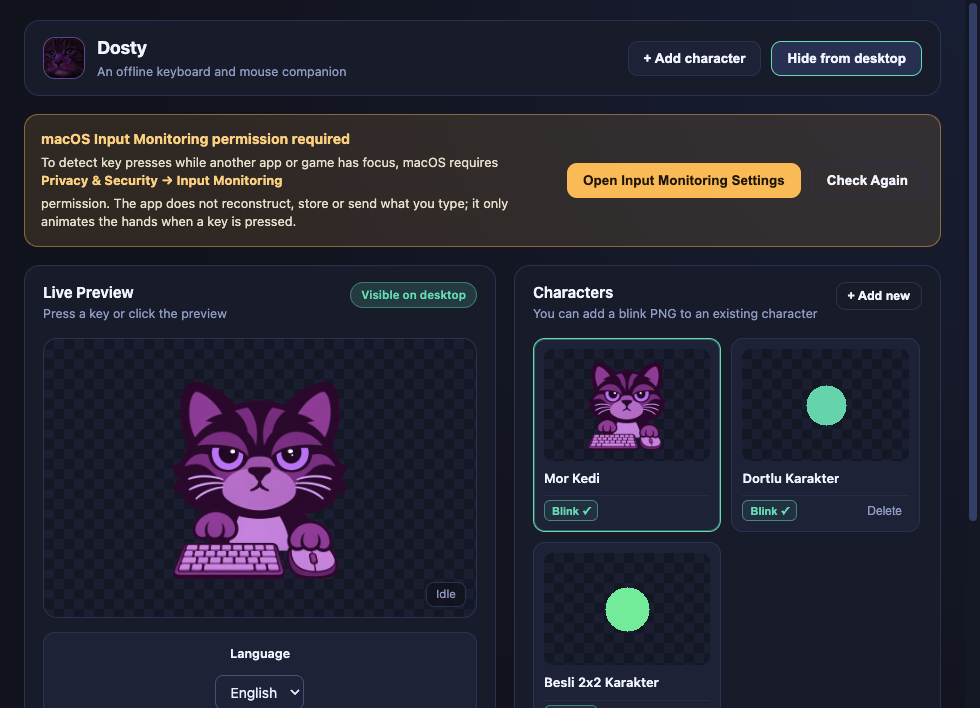

# Dosty

[English](README.md) · [Türkçe](README.tr.md)

[](https://github.com/saido-11/Dosty/actions/workflows/release.yml)

**[Download Dosty 0.1.2 preview](https://github.com/saido-11/Dosty/releases/tag/v0.1.2)** · [Windows setup](https://github.com/saido-11/Dosty/releases/download/v0.1.2/dosty-0.1.2-win-x64-setup.exe) · [Windows portable](https://github.com/saido-11/Dosty/releases/download/v0.1.2/dosty-0.1.2-win-x64-portable.exe)

Your little desktop companion: **Dosty** taps along as you type and click in other apps. Use the included **Mor Kedi (Purple Cat)** or bring your own character. Switch between English and Turkish, drag your companion wherever you like, and keep everything offline. No account, API key or network connection is needed at runtime.




## Features

- Import four separate PNG poses: idle, keyboard, mouse, and keyboard + mouse.
- Alternatively import a 2×2 PNG sheet: top left = idle, top right = keyboard, bottom left = mouse, bottom right = both.
- Add an optional fifth, eyes-closed PNG for idle blinking, including to existing characters.
- Hold the left mouse button on visible character pixels and drag directly, without opening the controls or enabling move mode. Position is saved on release. Click-through remains enabled, so the underlying app may also receive the gesture.
- Align poses, move the desktop character freely, and enable a small bounce on visible-pixel clicks. Normal mode passes clicks through; move mode temporarily captures them until you drop the character.
- Switch **Türkçe / English** in Settings or the tray/menu-bar menu. Changes apply immediately and persist. Existing users keep Turkish; fresh installs use Turkish for a Turkish system language and English otherwise. User-assigned character names are preserved.
- Images are copied into the application's local data directory. The originals can be deleted after saving.

## Platforms and verification

Build targets are **macOS Apple Silicon (arm64, macOS 13+)** and **Windows x64**. The minimum Mac version is read from the packaged application manifest; only the host version below was tested. Intel Mac packages are not provided.

Local development and package checks were run on an Apple Silicon Mac with macOS 26.6.2. [GitHub Actions also passed on macOS and Windows x64](https://github.com/saido-11/Dosty/actions/runs/42505987951): 14 unit tests, Electron integration/restart checks, native compilation and package verification. On the Windows runner, the packaged native bridge registered both keyboard and mouse hooks, and the packaged Dosty executable initialized and kept its bundled bridge running. **Physical typing/clicking, direct dragging, games and fullscreen behavior on a user's Windows desktop still require acceptance testing.** See the [Windows test steps](docs/WINDOWS-TEST.md).

Automated Electron tests simulate DOM events and invoke animation methods. They check image loading, Purple Cat pose stability, blinking, touch hit testing, movement, localization, layout and restart persistence. They do **not** prove physical keyboard capture, click delivery to another app or native fullscreen visibility. See [validation notes](docs/VALIDATION.md).

## Run a packaged app

Download ready-to-run packages from the **[Dosty 0.1.2 preview release](https://github.com/saido-11/Dosty/releases/tag/v0.1.2)**. Release downloads are public and do not require GitHub sign-in. Windows setup/portable EXEs, the Mac arm64 ZIP/DMG and checksums are provided. GitHub's **Code → Download ZIP** contains source code; it is not an installable app. The [successful build](https://github.com/saido-11/Dosty/actions/runs/42505987951) also retains CI artifacts; the build workflow does not publish Releases automatically.

### macOS Apple Silicon

1. Download `dosty-0.1.2-mac-arm64.zip` or the corresponding DMG. Extract the ZIP, or open the DMG, and copy **Dosty.app** to Applications before granting permissions.
2. Open **Dosty.app**. Current packages have a local ad hoc signature and are **not Developer ID signed or notarized**. A GitHub download may therefore be blocked by macOS. If you trust this project and macOS offers it, follow Apple's per-app **Privacy & Security → Open Anyway** procedure. Do not disable Gatekeeper globally. This downloaded-app flow has not been tested on a second Mac. See [Apple's app-opening guide](https://support.apple.com/en-us/102445).
3. For global keyboard input, open **System Settings → Privacy & Security → Input Monitoring**, enable the exact **Dosty.app** copy you are running, then click **Check Again**. Quit and reopen if macOS requests it. See [Apple's Input Monitoring guide](https://support.apple.com/guide/mac-help/control-access-to-input-monitoring-on-mac-mchl4cedafb6/mac).
4. Select **Mor Kedi (Purple Cat)**, open a blank local text document, and type/click to test it. Hold the character's visible pixels to drag it directly.

**Each user grants permissions on their own Mac.** Downloading from GitHub does not transfer the developer's permissions or remove macOS checks. Moving or rebuilding the app can require granting permission again. Full Disk Access is not required. Direct mouse dragging can work without keyboard monitoring permission; global keyboard animation still needs it. Developer ID signing and notarization remain necessary for a smoother public Mac distribution.

If Input Monitoring is enabled but Dosty still reports no permission, quit all old app copies. Remove the stale Dosty entry from Input Monitoring and add the exact `/Applications/Dosty.app` copy again, then reopen it. Older packages may appear under the previous name. A checked switch for another copy is not proof that the current build has permission.

### Windows x64 — physical acceptance pending

Download the [setup installer](https://github.com/saido-11/Dosty/releases/download/v0.1.2/dosty-0.1.2-win-x64-setup.exe) or [portable executable](https://github.com/saido-11/Dosty/releases/download/v0.1.2/dosty-0.1.2-win-x64-portable.exe). The native input bridge is bundled; source users build it using the development steps below. Windows has no macOS-style Input Monitoring setting. These are test builds: hook registration and packaged startup passed on the Windows CI runner, while SmartScreen behavior, physical input, games and fullscreen visibility still need a real user test. Follow the [Windows acceptance steps](docs/WINDOWS-TEST.md).

Normal keyboard keys suppress autorepeat; keyboard and mouse strikes are independent. Secure-input fields, protected desktops, some games and OS restrictions can prevent capture. The current Mac bridge emits a Caps Lock strike when enabling Caps Lock, not when disabling it.

## Create your own character with ChatGPT

Copy the [full English character prompt](docs/character-prompt.en.md) or the [Turkish prompt](docs/character-prompt.tr.md) into ChatGPT with image generation. Replace the character description, choose four or five poses and separate PNGs or a 2×2 sheet. Attach reference artwork if you have it. The prompt is supplied by the project owner and keeps the face, framing and props consistent across poses.

Import the four poses in order: **idle → keyboard → mouse → both**. Add `blink.png` separately if you requested a fifth pose. Generated images may still need alignment or transparency corrections; Dosty includes pose-offset controls. Image generation is a separate step, not a built-in Dosty service.

## Development

Requirements: Node.js 22+, npm, and the native compiler for the platform:

- macOS: Xcode Command Line Tools (`xcode-select --install`).
- Windows: .NET Framework `csc.exe`, discovered under `%WINDIR%/Microsoft.NET/Framework64/v4.0.30319` or the Framework equivalent.

```sh
npm ci
npm start
```

`postinstall` builds the native input bridge. Develop outside cloud-synchronized folders. Keep local user data and private character artwork outside the repository.

```sh
npm test                 # Unit, storage and language migration/catalog checks
npm run test:e2e         # Electron integration checks, including a real app restart
npm audit                # Dependency advisories
npm run dist:mac -- --publish never  # arm64 DMG and ZIP; build on macOS
npm run dist:win -- --publish never  # x64 setup and portable EXEs; build on Windows
npm run verify:package -- "dist/mac-arm64/Dosty.app"
# Windows, after packaging:
npm run verify:package -- dist/win-unpacked
npm run test:packaged:win -- dist/win-unpacked  # Windows: hooks + packaged app startup
```

Artifacts are written to `dist/`. The Windows native bridge is compiled before packaging, copied to `resources/bin/input-bridge-win-x64.exe` in the packaged app, and spawned from that path. Setup and portable packages have distinct `-setup.exe` and `-portable.exe` names. The package verifier checks bridge presence; it does not prove that Win32 hooks work.

`.github/workflows/release.yml` tests and builds on each platform and uploads workflow artifacts. It does **not** publish GitHub Releases. Credentials and signing secrets are not committed.

The separate **Prepare draft downloads** workflow is manual only. It verifies a successful build and matching release source, then transfers its four packages and checksums to an existing unpublished draft inside GitHub. It never publishes the draft.

To share a prebuilt application through Releases, publish the matching source version and attach its packages. Keep `dist/` out of Git history. A real Windows acceptance test is still needed before presenting physical input and fullscreen behavior as verified.

## Project layout and privacy

- `src/i18n/`: central Turkish/English catalogs and shared translation fallback logic.
- `native/`: macOS Swift event tap and Windows C# low-level hook sources. Only momentary held-key state and anonymous strike events are used; typed text is not reconstructed, logged or sent.
- `resources/characters/mor-kedi/`: bundled five-pose Purple Cat artwork.
- `resources/icons/`: supplied PNG, ICNS, ICO and tray logo assets.
- `docs/character-prompt.*.md`: copyable English and Turkish character-generation prompts.
- `scripts/generate-sample-assets.mjs`: legacy procedural samples, generated only under ignored `out/`; it does not replace the supplied Purple Cat or logo.

`node_modules`, `dist`, generated native binaries, test output, local user data, logs, environment files and signing secrets are ignored. Native binaries are rebuilt from source. The lockfile is included. The minimatch override resolves build-tool advisories; package generation is checked with this resolution.

Fresh installations store settings and imported artwork in the OS application-data folder under `Dosty`. Upgrades reuse an existing `Masaüstü Karakter` library in place so names, images, language and position are preserved. The legacy internal application ID is retained for update continuity; it is not the displayed name.

## License

Dosty's original source code and bundled project artwork are licensed under **GNU GPL version 3 only (GPL-3.0-only)**, selected by the project owner. See [LICENSE](LICENSE) for the full terms. When distributing binaries, provide the corresponding source under those terms. Third-party components retain their own licenses; see [THIRD_PARTY_NOTICES.md](THIRD_PARTY_NOTICES.md). Your own imported character files stay on your computer and are not uploaded to this repository.
