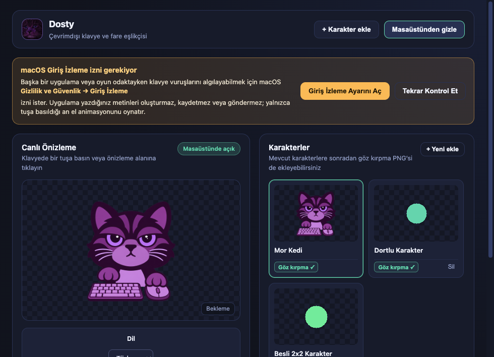

# Dosty

[English](README.md) · [Türkçe](README.tr.md)

[](https://github.com/saido-11/Dosty/actions/workflows/release.yml)

## İndir

| Platform | İndir | Alternatif |
| --- | --- | --- |
| **Windows (64 bit)** | **[Windows için indir — Kurulum (.exe)](https://github.com/saido-11/Dosty/releases/download/v0.1.2/dosty-0.1.2-win-x64-setup.exe)** | [Taşınabilir — kurulum gerekmez](https://github.com/saido-11/Dosty/releases/download/v0.1.2/dosty-0.1.2-win-x64-portable.exe) |
| **Mac (Apple Silicon, M1 ve sonrası · macOS 13+)** | **[Mac için indir (.dmg)](https://github.com/saido-11/Dosty/releases/download/v0.1.2/dosty-0.1.2-mac-arm64.dmg)** | [ZIP](https://github.com/saido-11/Dosty/releases/download/v0.1.2/dosty-0.1.2-mac-arm64.zip) |

Sürüm **0.1.2 ön sürüm** · [Tüm indirmeler ve sürüm notları](https://github.com/saido-11/Dosty/releases/tag/v0.1.2) · [Kurulum ve Mac izinleri](#paketlenmiş-uygulama)

GitHub hesabı gerekmez. Intel Mac paketi bulunmuyor.

Masaüstündeki küçük dostunuz **Dosty**, başka uygulamalarda yazarken ve tıklarken size elleriyle eşlik eder. Hazır **Mor Kedi** ile başlayın veya kendi karakterinizi ekleyin. Türkçe ve İngilizce arasında geçiş yapın, karakterinizi istediğiniz yere sürükleyin ve her şeyi çevrimdışı kullanın. Hesap, API anahtarı veya internet bağlantısı gerekmez.




## Özellikler

- Dört ayrı PNG yükleyin: bekleme, klavye, fare, klavye + fare.
- Alternatif 2×2 PNG sırası: sol üst bekleme, sağ üst klavye, sol alt fare, sağ alt ikisi.
- Boştayken göz kırpmak için isteğe bağlı beşinci, gözler kapalı PNG ekleyin. Mevcut karakterlere de eklenebilir.
- Karakterin görünür kısmına sol tuşla basılı tutup doğrudan sürükleyin; kontrol penceresini veya taşıma modunu açmanız gerekmez. Bırakınca konum kaydedilir. Tıklama geçirgenliği korunduğu için alttaki uygulama da fare hareketini alabilir.
- Pozları hizalayın, karakteri serbestçe taşıyın, görünür piksellere tıklandığında hafif zıplama tepkisini açın. Normal modda tıklama alta geçer; taşıma modunda bırakana kadar karakter tarafından yakalanır.
- Ayarlardan veya tepsi/menü çubuğundan **Türkçe / English** seçin. Seçim anında uygulanır ve hatırlanır. Mevcut kullanıcılar Türkçe kalır; yeni kurulumda Türkçe sistem dili Türkçe, diğer diller İngilizce açılır. Kullanıcının karakter adları değiştirilmez.
- Kaydederken görseller uygulamanın yerel veri klasörüne kopyalanır; orijinaller sonradan silinebilir.

## Platformlar ve doğrulama

Paket hedefleri **macOS Apple Silicon (arm64, macOS 13+)** ve **Windows x64**. En düşük Mac sürümü paket manifestinden okunmuştur; yalnızca aşağıda belirtilen sistemde test yapılmıştır. Intel Mac paketi yoktur.

Yerel geliştirme ve paket kontrolleri macOS 26.6.2 kullanan Apple Silicon Mac'te yapıldı. [GitHub Actions, macOS ve Windows x64 üzerinde başarıyla tamamlandı](https://github.com/saido-11/Dosty/actions/runs/42505987951): 14 birim testi, Electron entegrasyon/yeniden açılış kontrolleri, yerel köprü derlemesi ve paket doğrulaması geçti. Windows koşucusunda paket içindeki köprü klavye ve fare giriş kancalarını kurdu; paketlenmiş Dosty açılıp kendi köprüsünü çalışır tuttu. **Kullanıcının Windows masaüstünde gerçek tuş/tıklama, doğrudan sürükleme, oyun ve tam ekran davranışları hâlâ denenmelidir.** [Windows deneme adımları](docs/WINDOWS-TEST.md).

Electron testleri sentetik DOM olayları ve animasyon metodu çağrıları kullanır. Görsel yükleme, Mor Kedi poz kararlılığı, göz kırpma, dokunma, taşıma, dil, yerleşim ve yeniden açılışı kontrol eder. Fiziksel tuş yakalamayı, alttaki uygulamaya tıklamanın ulaşmasını veya gerçek tam ekran görünürlüğünü tek başına kanıtlamaz. [Doğrulama notları](docs/VALIDATION.md).

## Paketlenmiş uygulama

Hazır paketleri **[Dosty 0.1.2 ön sürüm sayfasından](https://github.com/saido-11/Dosty/releases/tag/v0.1.2)** indirin. Sürüm dosyaları herkese açıktır; indirmek için GitHub oturumu gerekmez. Windows kurulum/taşınabilir EXE'leri, Mac arm64 ZIP/DMG ve doğrulama değerleri sunulur. GitHub'daki **Code → Download ZIP**, kurulabilir uygulamayı değil kaynak kodu indirir. [Başarılı derlemenin](https://github.com/saido-11/Dosty/actions/runs/42505987951) CI çıktıları da korunur; derleme akışı kendiliğinden Release yayımlamaz.

### macOS Apple Silicon

1. `dosty-0.1.2-mac-arm64.zip` veya karşılık gelen DMG'yi indirin. ZIP'i çıkarın ya da DMG'yi açın; izin vermeden önce **Dosty.app** uygulamasını Uygulamalar klasörüne kopyalayın.
2. **Dosty.app** uygulamasını açın. Mevcut paket yerel ad hoc imzalıdır; **Developer ID imzası ve notarization içermez**. Bu nedenle GitHub'dan indirilen kopyayı macOS engelleyebilir. Projeye güveniyorsanız ve macOS bu seçeneği sunuyorsa Apple'ın uygulamaya özel **Gizlilik ve Güvenlik → Yine de Aç** adımlarını izleyin. Gatekeeper'ı tüm sistem için kapatmayın. İnternetten indirilmiş kopyanın bu açılışı ikinci bir Mac'te denenmedi. [Apple'ın uygulama açma rehberi](https://support.apple.com/en-us/102445).
3. Genel klavye girişi için **Sistem Ayarları → Gizlilik ve Güvenlik → Giriş İzleme** bölümünde çalıştırdığınız **Dosty.app** kopyasına izin verin; uygulamada **Tekrar Kontrol Et**'e basın. macOS isterse kapatıp yeniden açın. [Apple'ın Giriş İzleme rehberi](https://support.apple.com/guide/mac-help/control-access-to-input-monitoring-on-mac-mchl4cedafb6/mac).
4. Mor Kedi'yi seçin; boş bir yerel metin belgesinde yazıp tıklayarak deneyin. Karakteri taşımak için çiziminin üzerinden basılı tutup sürükleyin.

**Her kullanıcı kendi Mac'inde izin verir.** GitHub'dan indirmek sizin izinlerinizi arkadaşınıza aktarmaz ve macOS kontrollerini kaldırmaz. Uygulama taşınınca veya yeniden derlenince yeniden izin gerekebilir. Tam Disk Erişimi gerekmez. Fareyle doğrudan sürükleme klavye izni olmadan da çalışabilir; diğer uygulamalardaki klavye animasyonu için izin gerekir. Daha sorunsuz herkese açık Mac dağıtımı için Developer ID imzası ve notarization hâlâ gereklidir.

Giriş İzleme açıkken Dosty hâlâ izin olmadığını söylüyorsa eski uygulama kopyalarını kapatın. Giriş İzleme'deki eski Dosty kaydını kaldırıp tam olarak `/Applications/Dosty.app` kopyasını yeniden ekleyin ve uygulamayı açın. Eski paketler önceki adla görünebilir. Başka kopyanın anahtarının açık olması, çalışan sürümün izinli olduğunu kanıtlamaz.

### Windows x64 — gerçek kullanıcı denemesi bekliyor

[Kurulum dosyasını](https://github.com/saido-11/Dosty/releases/download/v0.1.2/dosty-0.1.2-win-x64-setup.exe) veya [taşınabilir uygulamayı](https://github.com/saido-11/Dosty/releases/download/v0.1.2/dosty-0.1.2-win-x64-portable.exe) indirin. Yerel giriş köprüsü pakete dahildir; kaynak koddan çalıştıranlar aşağıdaki geliştirme adımlarıyla derler. Windows'ta macOS'taki Giriş İzleme ayarı bulunmaz. Bunlar test paketleridir: giriş kancalarının kurulması ve paketlenmiş uygulamanın açılışı Windows CI koşucusunda geçti; SmartScreen, gerçek tuş/tıklama, oyun ve tam ekran görünürlüğü gerçek kullanıcıda ayrıca denenmelidir. [Windows deneme adımlarını](docs/WINDOWS-TEST.md) izleyin.

Normal tuşlarda otomatik tekrar bastırılır; klavye ve fare vuruşları bağımsızdır. Güvenli giriş alanları, korumalı masaüstleri, bazı oyunlar ve işletim sistemi kısıtları yakalamayı engelleyebilir. Mevcut Mac köprüsü Caps Lock açılırken vuruş üretir, kapatılırken üretmez.

## ChatGPT ile kendi karakterini oluştur

[Türkçe karakter promptunun tamamını](docs/character-prompt.tr.md) veya [İngilizce promptu](docs/character-prompt.en.md) görsel oluşturma destekli ChatGPT'ye kopyalayın. Karakter tarifini doldurun; dört veya beş poz, ayrı PNG veya 2×2 görsel seçin. Varsa referans görsellerinizi ekleyin. Proje sahibinin verdiği bu prompt yüzün, kadrajın ve nesnelerin pozlar arasında tutarlı kalmasını ister.

Dört pozu şu sırayla yükleyin: **bekleme → klavye → fare → ikisi birlikte**. Beşinci pozu istediyseniz `blink.png` dosyasını ayrıca ekleyin. Üretilen görsellerde hizalama veya şeffaflık düzeltmesi gerekebilir; Dosty'de poz kaydırma ayarları bulunur. Görsel oluşturma ayrı bir adımdır, Dosty'nin içine gömülü bir servis değildir.

## Geliştirme

Node.js 22+, npm ve platforma uygun yerel derleyici gerekir:

- macOS: Xcode Command Line Tools (`xcode-select --install`).
- Windows: `%WINDIR%/Microsoft.NET/Framework64/v4.0.30319` veya Framework altındaki .NET Framework `csc.exe`.

```sh
npm ci
npm start
npm test
npm run test:e2e
npm audit
npm run dist:mac -- --publish never
npm run dist:win -- --publish never
npm run verify:package -- "dist/mac-arm64/Dosty.app"
# Windows paketlemesinden sonra:
npm run verify:package -- dist/win-unpacked
npm run test:packaged:win -- dist/win-unpacked  # Windows: köprü ve paketli uygulama açılışı
```

`postinstall` yerel giriş köprüsünü derler. Kaynaklarla bulut senkronizasyonu dışındaki bir klasörde çalışın. Kişisel karakterleri ve kullanıcı verisini depoya koymayın.

Paketler `dist/` altındadır. Windows köprüsü paketleme öncesinde derlenir; paket içindeki `resources/bin/input-bridge-win-x64.exe` konumuna kopyalanır ve buradan başlatılır. Kurulum `-setup.exe`, taşınabilir paket `-portable.exe` ile ayrılır. Paket kontrolü köprünün bulunduğunu doğrular; Win32 hook'larının çalıştığını kanıtlamaz.

`.github/workflows/release.yml` iki platformda test ve paketleme yapar, iş akışı çıktısı yükler. GitHub sürümü yayımlamaz. Kimlik bilgileri ve imzalama sırları depoya konmaz.

Ayrı **Prepare draft downloads** akışı yalnızca elle başlatılır. Başarılı derlemeyi ve sürümün karşılık gelen kaynaklarını doğrulayıp dört paketi ve doğrulama değerlerini GitHub içinde mevcut, yayımlanmamış taslağa aktarır. Taslağı kendiliğinden yayımlamaz.

Hazır uygulamayı Releases üzerinden paylaşmak için karşılık gelen kaynak sürümünü yayımlayın ve o sürümün paketlerini ekleyin. `dist/` klasörünü Git geçmişine koymayın. Windows'ta gerçek giriş ve tam ekran davranışlarını doğrulanmış olarak sunmadan önce gerçek kullanıcı denemesi gerekir.

## Kaynaklar ve gizlilik

Merkezi çeviriler `src/i18n/`, Swift ve C# giriş köprüleri `native/`, Mor Kedi'nin beş pozu `resources/characters/mor-kedi/`, mevcut PNG/ICNS/ICO logo ve tepsi görselleri `resources/icons/` altındadır. Köprüler yalnızca geçici basılı tuş durumunu ve anonim vuruş olaylarını kullanır; yazılan metni oluşturmaz, kaydetmez veya göndermez.

`generate:assets`, eski örnekleri yalnızca Git tarafından yok sayılan `out/` altına üretir; Mor Kedi ve verilen logonun yerine yazmaz. `node_modules`, `dist`, derlenmiş köprüler, test çıktıları, kullanıcı verileri, günlükler, ortam dosyaları ve imzalama sırları yok sayılır. Kilit dosyası dahildir. minimatch çözümlemesi, derleme araçlarındaki güvenlik bildirimleri için sabitlenmiştir; paketleme bu çözümlemeyle kontrol edilir.

Karakter oluşturma promptları `docs/character-prompt.*.md` dosyalarındadır. Yeni kurulum ayarları ve yüklenen görseller işletim sisteminin uygulama verisi klasöründeki `Dosty` altında saklanır. Güncellemede mevcut `Masaüstü Karakter` kitaplığı yerinde kullanılmaya devam eder; adlar, görseller, dil ve konum korunur. Güncelleme sürekliliği için eski dahili uygulama kimliği korunmuştur; görünen ad Dosty'dir.

## Lisans

Dosty'nin özgün kaynak kodu ve projeyle dağıtılan görselleri, proje sahibinin seçimiyle **GNU GPL yalnızca sürüm 3 (GPL-3.0-only)** kapsamındadır. Tam koşullar [LICENSE](LICENSE) dosyasındadır. Derlenmiş uygulama dağıtırken bu koşullar altında karşılık gelen kaynak kodu da sağlayın. Üçüncü taraf bileşenlerin kendi lisansları korunur; [THIRD_PARTY_NOTICES.md](THIRD_PARTY_NOTICES.md) dosyasına bakın. Kendi yüklediğiniz karakterler bilgisayarınızda kalır, bu depoya yüklenmez.
